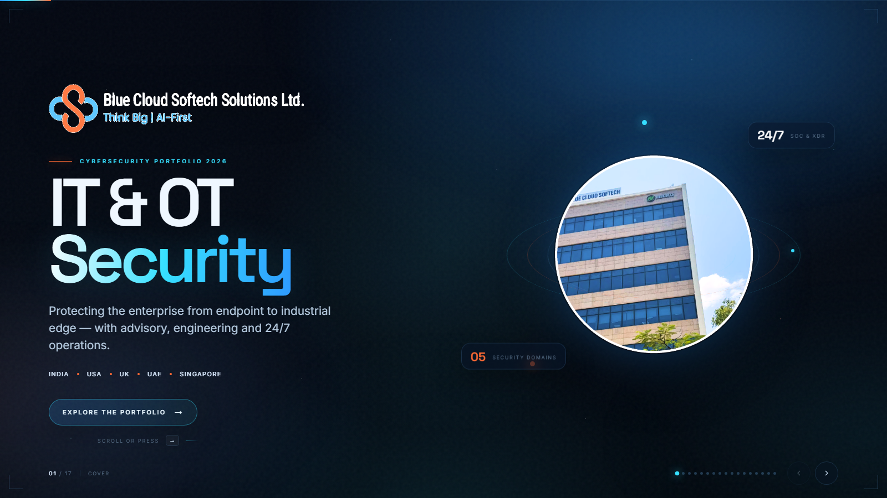

# BCSSL — IT & OT Security Experience

An interactive, cinematic 3D portfolio for **Blue Cloud Softech Solutions Ltd.**

**Live:** https://devasainandinimandapalli.github.io/bcssl-3d-experience/



## What's inside

- Cinematic boot sequence with a **SYSTEM READY** entry screen
- WebGL starfield, floating wireframes and warp transitions
- A real-time **3D network globe** with five glowing delivery nodes
- **Live threat-feed** panel with an interactive response simulation
- Mission-control HUD with session clock, sound, autoplay and slide index
- 3D slide transitions, mouse-tilt cards, particle cursor trail and scanline effects
- Optional sound design: ambient hum, UI clicks, whooshes and alert tones
- Cinematic autoplay mode for a hands-free loop
- Full-screen presentation, searchable slide index and keyboard/swipe navigation

## Controls

| Key | Action |
| --- | --- |
| `→` / `Space` / scroll | Next slide |
| `←` | Previous slide |
| `M` | Open the slide index |
| `Ctrl + K` | Open the index and search |
| `F` | Toggle fullscreen |
| `Esc` | Close the index |
| `Home` / `End` | First / last slide |

Hover cards for 3D tilt. Hover the capability panels to expand them. On the **Managed SOC & XDR** slide, press **Run response simulation** for the interactive threat demo. On the **Global presence** slide, hover a country to highlight its node on the globe.

Sound is **off by default** — use the **Sound** button in the top bar. The threat feed is illustrative, not live customer data.

## Run locally

Open `index.html` in Chrome or Edge, or serve the folder:

```bash
python -m http.server 8000
```

Then visit `http://localhost:8000`.

## Previous version

The original interactive portfolio is preserved at:
https://devasainandinimandapalli.github.io/bcssl-3d-portfolio/

## Notes

- All logos and images are local in `assets/`.
- Google Fonts and Three.js load from CDNs when online; the deck falls back gracefully.
- Best viewed on a 16:9 screen (1920×1080 or 1600×900) with fullscreen enabled.
